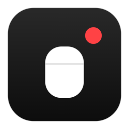
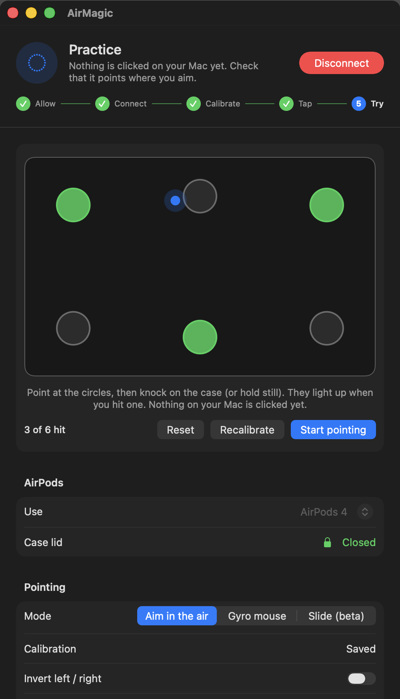
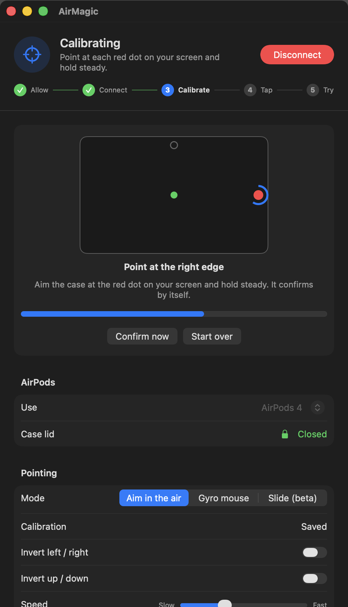
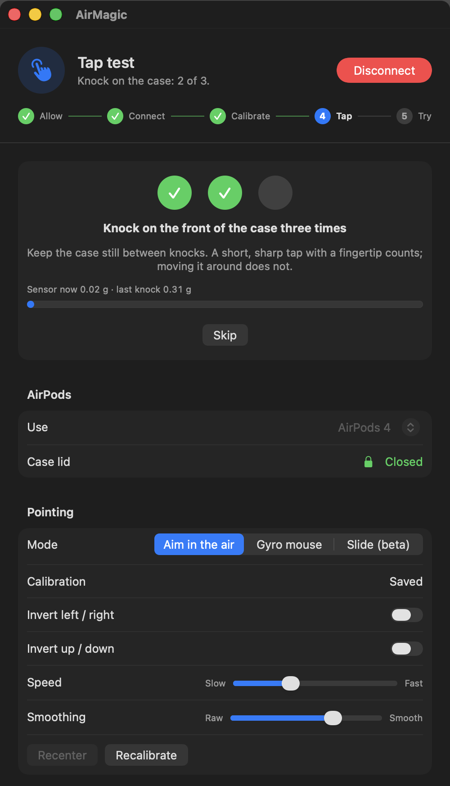
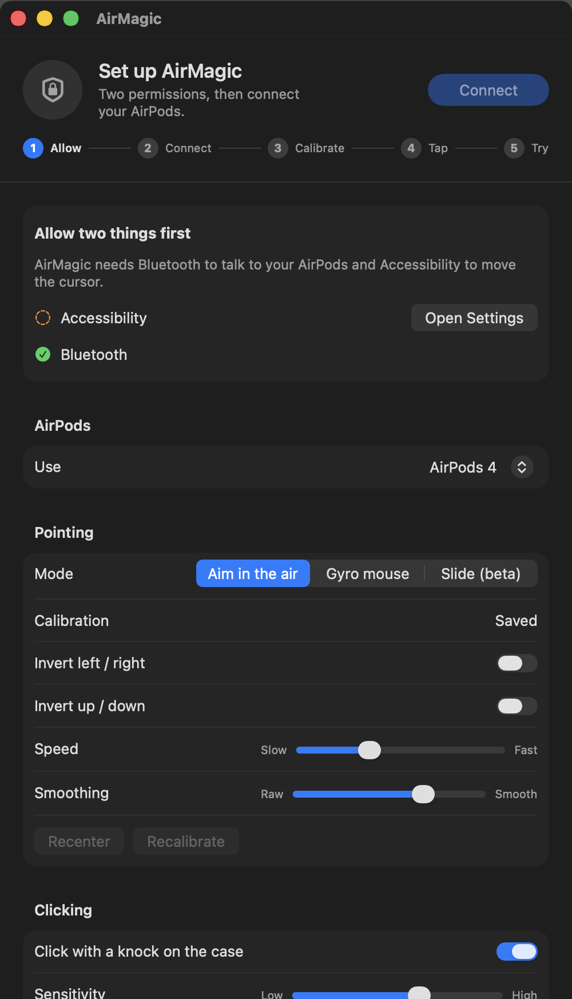
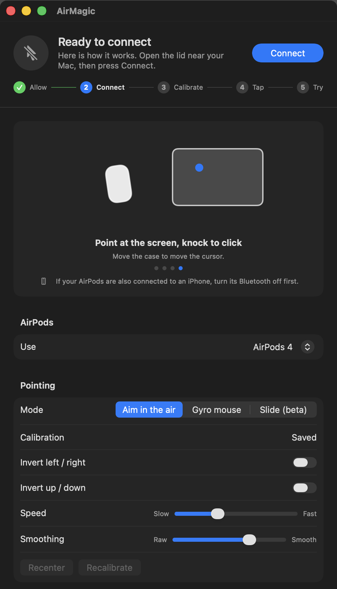
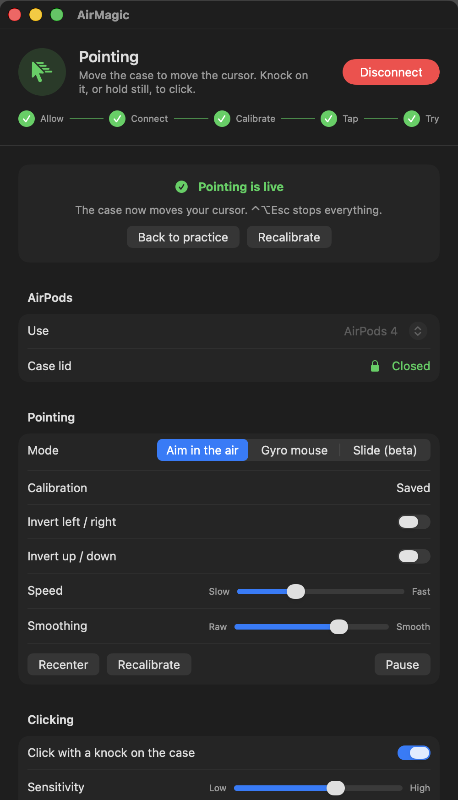
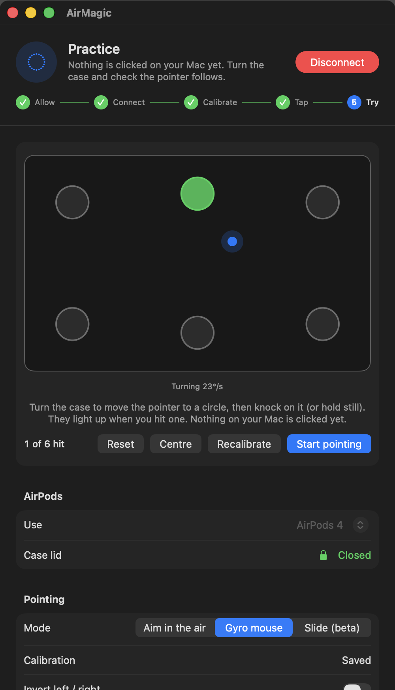
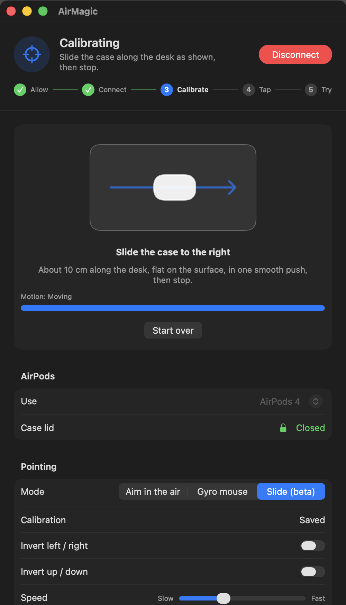

<p align="center">
  
</p>

<h1 align="center">AirMagic</h1>

<p align="center">
  <strong>Turn your AirPods charging case into a cursor.</strong><br>
  Point it, turn it or slide it. Knock on it to click.
</p>

<p align="center">
  
  
  
  
</p>

<p align="center">
  
  
  
</p>

AirMagic is a small macOS app that reads the motion sensors of your AirPods while they
sit in the **closed case**, and turns that motion into pointer movement. Move the case to
move the cursor, knock on the front of it to click. No dongle, no extra hardware: just the
AirPods you already own.

It comes with a guided setup, a **practice pad** where you can try everything before it
touches your real cursor, and an emergency stop you can hit from any app.

> **Unofficial and experimental.** AirMagic talks to the AirPods over an undocumented
> Bluetooth protocol and uses private macOS APIs. It is not affiliated with or endorsed
> by Apple. Read [Side effects](#side-effects) before you use it.

## Highlights

- **Works with the lid closed.** The case keeps streaming the earbud's accelerometer and
  gyroscope (200 samples per second). AirMagic keeps that stream alive with a
  once-a-second conversation with the earbud and the case.
- **Three ways to point.** Aim like a laser pointer, turn it like an air mouse, or slide
  it across the desk like a mouse. [Details below](#three-ways-to-point).
- **Knock to click.** A knock detector tuned on recordings of real taps (it found 15 of 15
  in a recorded run, with a few false hits on rough handling), plus click-by-holding-still.
- **Safe to try.** The practice pad shows a virtual pointer and virtual clicks. Nothing
  on your Mac moves until you press **Start pointing**, and `⌃⌥Esc` stops everything.
- **Guided setup.** Allow → Connect → Calibrate → Tap → Try, with an animated "how it
  works" and live feedback at every step.
- **Native.** A SwiftUI window plus a menu bar item, with light and dark mode for free.

## Three ways to point

Choose the mode under **Pointing** in the window.

| Mode | How you use it | How it works | How well it works |
|---|---|---|---|
| **Aim in the air** | Hold the case upright and point it at the screen, like a laser pointer. | Absolute: a three-point calibration maps the case's orientation to a place on the screen. The pose comes from the gyroscope, pulled toward gravity by the accelerometer. | Solid. The gyroscope measures rotation directly. It can drift in yaw over time: use **Recenter**. |
| **Gyro mouse** | Turn the case: the pointer moves while it turns and stops when it stops. | Relative, like an air mouse. Two short turns calibrate the axes. The pointer follows the rotation rate, with a dead zone, a filter that drops the jolt of a knock, and an acceleration curve. | Solid, no drift to fight. Feels like aiming, but relative. |
| **Slide (beta)** | Lay the closed case flat on a smooth surface and slide it like a mouse. Lift it to pause. | Relative. The acceleration is integrated into movement, with the resting offset relearned after each stop, spikes filtered, and velocity forced to zero when a stroke ends. Two strokes calibrate the directions. | Experimental. Directions come out right; distances only roughly (off by up to a factor of two), and the pointer can jump. An accelerometer cannot measure distance, only acceleration. |

Every mode has **Invert left / right** and **Invert up / down**, a **Speed** slider and
(for the aiming modes) a **Smoothing** slider. Check the result in the practice pad and
flip an invert switch if the pointer goes the wrong way.

## Quick start

You need macOS 14 or later, the Xcode command line tools (`xcode-select --install`) and
AirPods with a charging case paired with the Mac. AirPods Max have no case and are not
supported.

```sh
git clone git@github.com:yerkovlad/airMagic.git
cd airMagic
zsh ./install.sh
```

`install.sh` builds the app, runs the offline self-test, copies `AirMagic.app` to
`/Applications` and opens it. To build without installing, run `zsh ./build.sh`.

The app is signed ad hoc with a fixed designated requirement (`identifier "local.airmagic"`),
so the permissions you grant survive rebuilds.

## The guided setup

<table>
  <tr>
    <td width="50%" valign="top">
      <b>1. Allow.</b> AirMagic needs <b>Bluetooth</b> to talk to the AirPods and
      <b>Accessibility</b> to move the cursor. The window shows what is missing and
      opens System Settings for you.
    </td>
    <td width="50%"></td>
  </tr>
  <tr>
    <td width="50%" valign="top">
      <b>2. Connect.</b> Put both AirPods in the case, open the lid near the Mac, and make
      sure they are connected to this Mac (not to your iPhone). An animation shows what to
      do. Press <b>Connect</b>: audio drops for a moment while the link is re-established.
      Then close the lid and hold the case still.
    </td>
    <td width="50%"></td>
  </tr>
  <tr>
    <td width="50%" valign="top">
      <b>3. Calibrate.</b> Three red dots appear on your screen in turn: the middle, the right
      edge and the top edge. Point the case at each and hold it steady for about a second:
      each step confirms itself. (The other modes calibrate with two short turns or
      strokes, shown the same way.)
    </td>
    <td width="50%"></td>
  </tr>
  <tr>
    <td width="50%" valign="top">
      <b>4. Tap.</b> Knock on the front of the case three times. Three circles fill up and
      the knock threshold is set from your knocks. You can skip it.
    </td>
    <td width="50%"></td>
  </tr>
  <tr>
    <td width="50%" valign="top">
      <b>5. Try.</b> A small virtual screen with six circles. The pointer in it follows the
      case, and knocks or holds light up the circles. <b>Your real cursor does not move and
      nothing is clicked.</b> If it points the wrong way, press <b>Recalibrate</b> or tune
      <b>Speed</b>. When it feels right, press <b>Start pointing</b>.
    </td>
    <td width="50%"></td>
  </tr>
</table>

Saved calibration is reused next time: you only re-confirm the middle point, then check
it in the practice pad.

<p align="center">
  
  
  
</p>

## Clicking

- **Knock on the case.** A knock is a short, sharp spike in the accelerometer (at most
  about 50 ms wide) after a calm stretch. Moving or aiming the case makes wider bumps and
  is ignored. The verdict comes 100 ms after the impact, so the click lands where the
  pointer was before the knock. The threshold has a slider and **Test taps** sets it
  from your own knocks.
- **Click by holding still.** Off, 0.7 s, 1.0 s or 1.5 s: the pointer rests and clicks.

## Shortcuts

| Keys | Action |
|---|---|
| `⌃⌥Esc` | Stop everything now and give the cursor back. Works in any app. |
| `⌃⌥P` | Pause / resume |
| `⌃⌥Space` | Confirm a calibration step |

Closing the window leaves AirMagic running in the menu bar (the Dock icon goes away).
Open it again from Launchpad or Spotlight, or choose **Open AirMagic…** in the menu bar
menu.

## Side effects

AirMagic reaches the case the same way other tools of this kind do, and that has
consequences:

- **Audio drops.** Each connect drops the AirPods' Bluetooth link for a moment. Do not
  connect during a call.
- **Case diagnostics are used up.** To keep the sensor stream alive while the lid is
  closed, AirMagic accepts the diagnostic asset the case offers and releases it on exit.
  Releasing it can consume the diagnostic records staged on the case.
- **Private APIs.** It uses private IOBluetooth selectors. Any macOS update may break
  it. Each selector is checked before use, so it fails with a message instead of crashing.
- **One device at a time.** If the AirPods are also connected to an iPhone or iPad, the
  earbud may ignore this Mac. Turn Bluetooth off on the other device.
- **No guarantees.** Nothing here is tested against sleep/wake, Bluetooth loss during a
  session, or calls. Use it at your own risk.

## Troubleshooting

Every session writes a log to `~/Library/Application Support/AirMagic/link.log` (replaced
on each connect). The window's **Activity log** shows the latest lines.

| Message | Meaning |
|---|---|
| code 20 | Bluetooth permission not granted |
| code 22 / 23 | The AirPods are not paired / not connected to this Mac |
| code 24 | macOS changed its private Bluetooth internals |
| code 25 | Another app (for example another pointer tool) owns the AirPods channel |
| code 27 / 28 | No control channel, or the AirPods did not answer: reopen the lid and retry |
| code 30 | No motion data: the AirPods may also be connected to an iPhone |
| code 43 / 44 | The stream stopped or the link dropped |
| "The AirPods are not answering" / lost right after closing the lid | The AirPods are probably also connected to an iPhone or iPad. Turn Bluetooth off on that device (or set its AirPods to *When Last Connected to This iPhone*), then connect again |
| "Lost the AirPods" | No data for 3 seconds; the connection is reported as lost |

If the cursor races around after calibration, press `⌃⌥Esc`, connect again and hold the
case still on each dot. If it drifts over time, use **Recenter**.

## How it works

One executable, three modes:

```
AirMagic                  the menu bar app and its window
AirMagic --link ADDRESS   the Bluetooth child process the app starts
AirMagic --self-test      offline checks (no AirPods needed)
```

```
AirPods ──Bluetooth (L2CAP PSM 0x1001)──▶ AirMagic --link ──samples──▶ AirMagic (app)
 earbud + case                            handshake, start sensors,      pose, aiming / gyro /
 accelerometer + gyro                     keep-alive with earbud + case  slide, knocks, clicks
```

| File | What it does |
|---|---|
| `Sources/Wire.swift` | Packet framing, protobuf helpers, message builders |
| `Sources/Session.swift` | The earbud / case conversation, free of I/O so it can be tested |
| `Sources/Link.swift` | Child process: opens the AirPods control channel, starts the sensors, streams samples |
| `Sources/Pointing.swift` | Pose from gyro + accelerometer, aiming, smoothing, the gyro mouse, tap detection |
| `Sources/Slide.swift` | The sliding mouse (beta) |
| `Sources/Recorder.swift` | Records the sliding test |
| `Sources/Overlay.swift` | The red calibration dot on the screen (all words are in the window) |
| `Sources/Model.swift` | Observable state the window shows, and the actions it can trigger |
| `Sources/MainView.swift`, `Sources/Cards.swift` | The SwiftUI window and its step cards |
| `Sources/App.swift` | App delegate: window, menu bar, link control, calibration, cursor, clicks |
| `Sources/SelfTest.swift` | Offline checks |

In short: the app opens the AirPods control channel right after a fresh reconnect, starts
the accelerometer and gyroscope, and keeps the stream alive with a once-a-second
conversation with the earbud and the case (the case would otherwise close the stream a few
seconds after the lid shuts). The pose is integrated from the gyroscope and pulled toward
gravity by the accelerometer; the mode maps it to the screen; a One Euro filter smooths it.

## Development

```sh
zsh ./build.sh        # build + sign + run the self-test
./AirMagic.app/Contents/MacOS/AirMagic --self-test
```

The self-test covers the wire format byte for byte, the case conversation against
simulated replies, the pose maths, the three pointing modes, the knock detector and the
recorder. It does not cover real AirPods.

Optional checks against recordings:

```sh
# the knock detector on recorded taps (segment,service,microseconds,x,y,z)
AIRMAGIC_TAP_FIXTURES=/path/to/TapFixtures.csv ./AirMagic.app/Contents/MacOS/AirMagic --self-test

# the sliding mouse on a recording made with "Record a test…"
AIRMAGIC_SLIDE_CSV="$HOME/Library/Application Support/AirMagic/slide-test.csv" \
  ./AirMagic.app/Contents/MacOS/AirMagic --self-test
```

**Review the window without AirPods.** Open it with test data, and optionally save a picture:

```sh
open -n AirMagic.app --args --preview=practice
open -n AirMagic.app --args --preview=practice --snapshot=/absolute/path/practice.png
```

States: `permissions`, `connecting`, `settling`, `calibrating`, `taptest`, `practice`,
`pointing`, `mouseidle`, `mouse`, `mousepractice`, `slide`, `slidepractice`, `record`
(omit the flag for the idle screen). The screenshots in this README were made this way.

**The sliding test.** The slide mode was tuned on a recording of real slides, and you can
make one to tune it further. Connect, then press **Record a test…** (in the window or the
menu bar menu) and follow the prompts for about 75 seconds: slide right, left, away,
toward, diagonally, slowly, quickly, tap the desk, lift the case. The data is saved to
`~/Library/Application Support/AirMagic/slide-test.csv` (`S,service,stamp,x,y,z` for
samples and `M,stamp,label` for the start of each step), so an algorithm can be scored
against the known distances (about 10 cm).

## Status

Tested on one Mac (macOS 26, Apple Silicon) with one pair of AirPods 4. Other AirPods
with a charging case (AirPods Pro 2/3, AirPods 4 with ANC) are accepted by the code but
untested. Expect rough edges.

## Credits

The knowledge of how the AirPods control channel behaves (the channel and its handshake,
the sensor-start message, the case keep-alive) comes from reading
[oscarcreatess/airpointer](https://github.com/oscarcreatess/airpointer) (MIT), whose
author reverse-engineered it. AirMagic contains no code from that project; `Wire.swift`
and `Session.swift` are an independent implementation. The knock detector was tuned on
the recorded taps in that project's test fixtures.

## License

[MIT](LICENSE)
